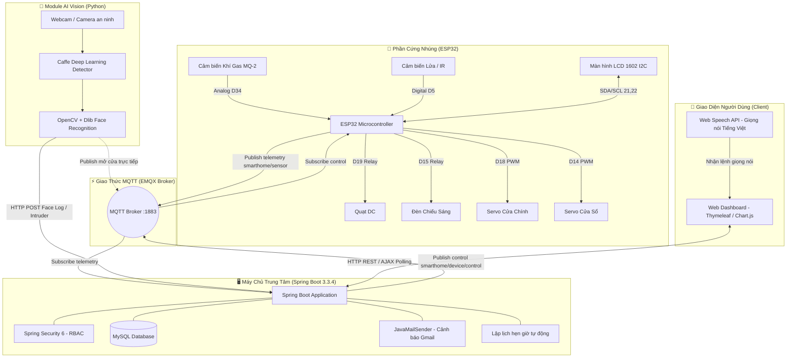
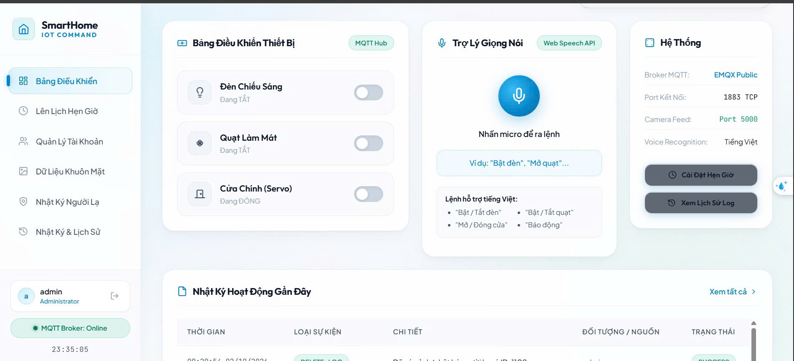
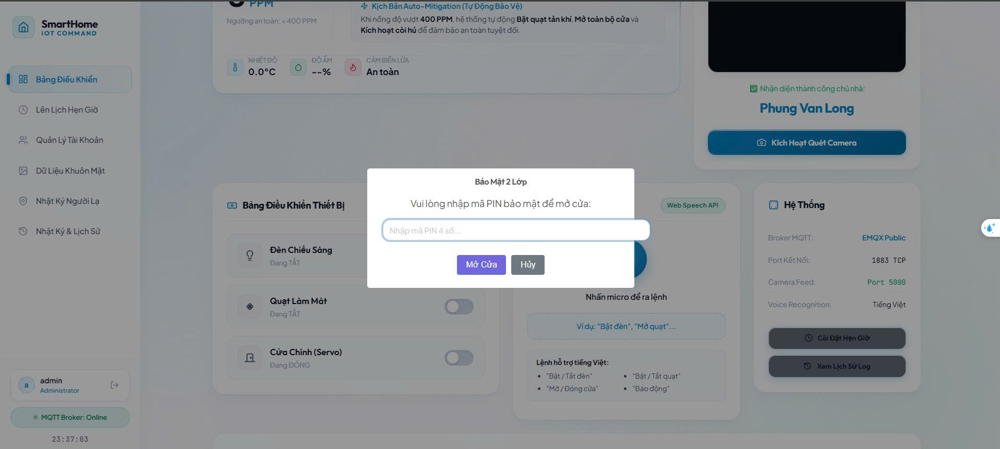
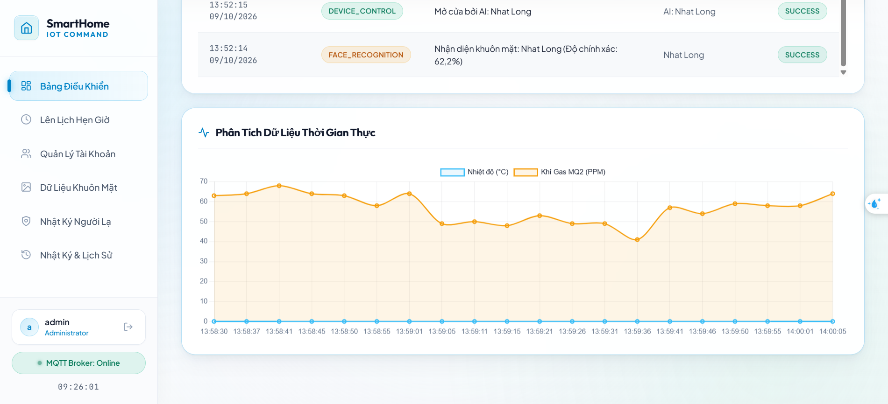
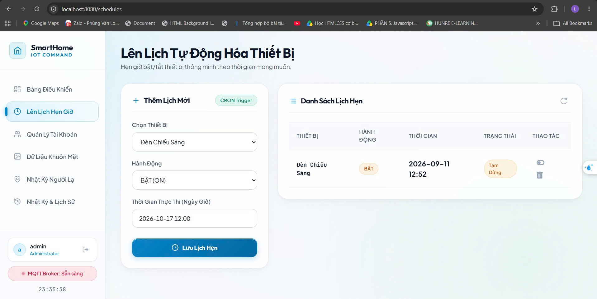
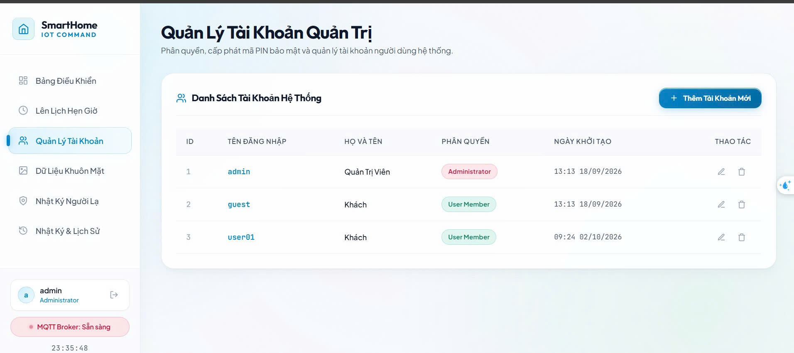
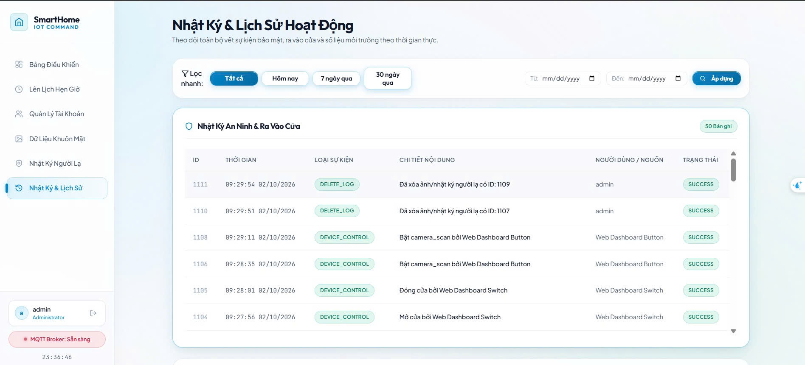
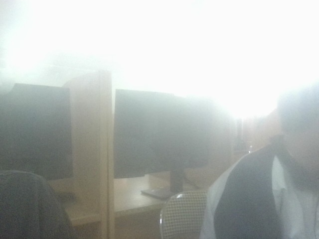
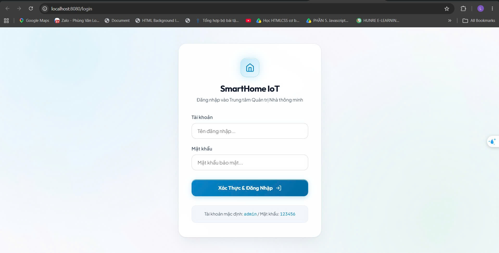

# 🏠 SmartHome IoT - Hệ Thống Nhà Thông Minh Đa Nền Tảng (IoT, AI Vision & Spring Boot)

<p align="center">
  
  
  
  
  
  
  
  
</p>

---

## 📌 Giới Thiệu Tổng Quan (Overview)

**SmartHome IoT** là một hệ thống nhà thông minh toàn diện kết hợp giữa **Phần cứng nhúng (ESP32)**, **Trí tuệ nhân tạo thị giác máy tính (AI Face Recognition)** và **Máy chủ Backend tập trung (Spring Boot)**. 

Hệ thống cung cấp giải pháp tự động hóa gia đình, cảnh báo rủi ro cháy nổ/rò rỉ khí gas, kiểm soát ra vào an ninh bằng nhận diện khuôn mặt và cho phép người dùng điều khiển thiết bị linh hoạt thông qua Web Dashboard hoặc **Giọng nói tiếng Việt**.

---

## 🏗️ Kiến Trúc Hệ Thống (System Architecture)



---

## ✨ Tính Năng Nổi Bật (Key Features)

### 1. 🛡️ An Ninh & Nhận Diện Khuôn Mặt AI (AI Face Recognition)
- **Mở cửa tự động:** Camera quét khuôn mặt thời gian thực; khi nhận diện đúng chủ nhà, hệ thống lập tức mở khóa cửa (Servo 90°), lưu log vào CSDL và chào mừng trên màn hình LCD.
- **Phát hiện kẻ lạ (Intruder Detection):** Khi phát hiện khuôn mặt không xác định lặp lại, hệ thống tự động **chụp ảnh kẻ lạ**, tải lên server, ghi nhận nhật ký xâm nhập và gửi thông báo khẩn cấp.
- **Camera Live Stream:** Hỗ trợ xem trực tiếp luồng camera từ xa trên Web Dashboard qua giao thức Flask MJPEG Streaming.

### 2. 🔥 Giám Sát Môi Trường & Cảnh Báo An Toàn Thời Gian Thực
- Đọc liên tục thông số từ cảm biến **MQ-2 (Khí Gas/Khói)** và **Cảm biến Lửa (Flame Sensor)**.
- Khi nồng độ khí gas vượt ngưỡng nguy hiểm hoặc phát hiện lửa:
  - ESP32 tự động bật quạt thông gió công suất tối đa.
  - Kích hoạt chuông còi báo động tại chỗ.
  - Server Spring Boot lập tức kích hoạt **JavaMailSender** gửi email cảnh báo khẩn cấp đến chủ nhà.

### 3. 🎙️ Điều Khiển Đa Phương Thức (Multi-modal Control)
- **Web Dashboard Trực Quan:** Bật/tắt đèn, quạt, đóng/mở cửa từ bất kỳ đâu thông qua giao diện Web trực quan, cập nhật trạng thái thiết bị theo thời gian thực (Chart.js biểu đồ đường).
- **Điều khiển bằng giọng nói Tiếng Việt:** Tích hợp Web Speech API, cho phép ra lệnh tự nhiên: *"Bật đèn", "Tắt quạt", "Mở cửa chính"*.
- **Hẹn giờ thông minh (Scheduler Service):** Người dùng có thể thiết lập lịch hẹn giờ tự động bật/tắt thiết bị theo thời gian định trước trong ngày.

### 4. 🔒 Phân Quyền & Quản Trị Hệ Thống (RBAC & Security)
- Bảo mật mạnh mẽ với **Spring Security 6**, mật khẩu mã hóa chuẩn **BCrypt**.
- Phân quyền người dùng rõ ràng:
  - **ROLE_ADMIN:** Quản lý tài khoản người dùng, xem toàn bộ nhật ký hệ thống (System Logs), theo dõi cảnh báo kẻ đột nhập.
  - **ROLE_USER:** Giám sát môi trường, điều khiển thiết bị trong gia đình.

---

## 🔌 Sơ Đồ Đấu Nối Phần Cứng (Hardware Pinout Mapping)

| Thiết Bị / Cảm Biến | Loại Tín Hiệu | Chân ESP32 (GPIO) | Ghi Chú |
| :--- | :--- | :--- | :--- |
| **Cảm biến Khí Gas (MQ-2)** | Analog Input | `GPIO 34 (A0)` | Đọc nồng độ khói / rò rỉ khí gas |
| **Cảm biến Lửa / Hồng ngoại** | Digital Input | `GPIO 5` | Phát hiện tia lửa / nhiệt độ bất thường |
| **Màn hình LCD 1602 (I2C)** | I2C Communication | `GPIO 21 (SDA)`<br>`GPIO 22 (SCL)` | Hiển thị trạng thái kết nối & cảm biến |
| **Relay Quạt Làm Mát (Fan)** | Digital Output | `GPIO 19` | Điều khiển quạt DC thông gió |
| **Đèn Chiếu Sáng (Light)** | Digital Output | `GPIO 15` | Đèn phòng khách / ban công |
| **Servo Cửa Chính (Servo 1)** | PWM Output | `GPIO 18` | Đóng / mở cửa ra vào chính (0° - 90°) |
| **Servo Cửa Sổ / Phụ (Servo 2)** | PWM Output | `GPIO 14` | Đóng / mở rèm hoặc cửa phụ |

---

## 🛠️ Ngăn Xếp Công Nghệ (Tech Stack)

| Lĩnh Vực | Công Nghệ Sử Dụng |
| :--- | :--- |
| **Backend** | Java 17, Spring Boot 3.3.4 (Spring MVC, Spring Data JPA, Spring Security 6, Spring Mail) |
| **Cơ Sở Dữ Liệu** | MySQL 8.0, Hibernate ORM |
| **Frontend** | HTML5, CSS3, JavaScript (ES6+), Thymeleaf Template Engine, Chart.js, Web Speech API |
| **Giao Thức IoT** | MQTT (Eclipse Paho Client v1.2.5), HTTP RESTful API, WebSocket/AJAX Polling |
| **Phần Cứng (Firmware)** | ESP32 Dev Module, C/C++ (Arduino Framework, PubSubClient, ArduinoJson, ESP32Servo) |
| **Trí Tuệ Nhân Tạo (AI)** | Python 3.11, OpenCV, Dlib (`face_recognition`), Deep Neural Network (Caffe Model), Flask |

---

## 🖼️ Hình Ảnh Minh Họa Hệ Thống (Screenshots & System Showcase)

### 1. 📊 Bảng Điều Khiển & Trợ Lý Giọng Nói (Dashboard & Voice Assistant)
> Điều khiển đèn, quạt, servo cửa chính theo thời gian thực qua giao thức MQTT. Tích hợp micro nhận lệnh bằng giọng nói Tiếng Việt và theo dõi trạng thái Broker online.

<p align="center">
  
</p>

---

### 2. 🤖 AI Nhận Diện Khuôn Mặt & Bảo Mật 2 Lớp (AI Face Unlock & 2FA PIN)
> Camera AI quét khuôn mặt chủ nhà thời gian thực, mở khóa cửa tự động. Hỗ trợ popup xác thực mã PIN bảo mật 2 lớp cùng kịch bản Auto-Mitigation tự động bật quạt, hú còi khi phát hiện nguy cơ rò rỉ khí gas.

<p align="center">
  
</p>

---

### 3. 📈 Phân Tích Dữ Liệu Cảm Biến Thời Gian Thực (Telemetry Analytics)
> Biểu đồ đường động (Chart.js) cập nhật liên tục nồng độ khí Gas MQ-2 (PPM) và nhiệt độ môi trường, giúp theo dõi biến động môi trường sống trực quan.

<p align="center">
  
</p>

---

### 4. ⏰ Lên Lịch Tự Động Hóa Thiết Bị (Cron Triggers & Schedules)
> Thiết lập lịch trình bật/tắt thiết bị thông minh theo thời gian mong muốn với cơ chế Cron Scheduler chạy ngầm.

<p align="center">
  
</p>

---

### 5. 👥 Quản Trị Hệ Thống & Nhật Ký Hoạt Động (RBAC & Audit Trail)

| Quản Lý Tài Khoản Quản Trị (RBAC) | Nhật Ký & Lịch Sử Hoạt Động (Audit Trail) |
| :---: | :---: |
|  |  |
| *Phân quyền Administrator và User Member* | *Lọc sự kiện, thời gian và chi tiết tương tác* |

---

### 6. 🚨 Cảnh Báo Phát Hiện Kẻ Lạ & Xác Thực Đăng Nhập

| Bắt Ảnh Kẻ Đột Nhập (Intruder Alert) | Giao Diện Xác Thực & Đăng Nhập |
| :---: | :---: |
|  |  |
| *Tự động chụp ảnh kẻ lạ gửi về Server & Email* | *Đăng nhập bảo mật Spring Security* |

---

## 📁 Cấu Trúc Dự Án (Project Structure)

```
IoTBTL/
├── .gitignore
├── README.md                           # Tài liệu tổng quan dự án
├── docs/                               # Tài liệu & hình ảnh minh họa
│   └── images/                         # Ảnh chụp demo giao diện & phần cứng
│
├── SmartHome_SpringBoot/               # Source code Backend Spring Boot
│   ├── src/main/java/com/phungvanlong/smarthome/
│   │   ├── config/                     # Cấu hình Security, MQTT, Web
│   │   ├── controllers/                # WebController, ApiController, AdminController
│   │   ├── entities/                   # UserAccount, SensorData, SystemLog, DeviceSchedule
│   │   ├── repositories/               # Spring Data JPA Repositories
│   │   └── services/                   # MqttService, DeviceService, EmailService, AiLogService
│   ├── src/main/resources/
│   │   ├── static/                     # CSS, JS (voice, realtime dashboard, schedules), Ảnh kẻ lạ
│   │   ├── templates/                  # Giao diện Thymeleaf HTML
│   │   └── application.properties      # Cấu hình Database, Mail, MQTT Broker
│   └── pom.xml
│
├── SmartHome_ESP32/                    # Firmware phần cứng IoT
│   └── SmartHome_ESP32.ino             # Code C++ nạp cho ESP32 qua Arduino IDE
│
└── SmartHome_AIVision/                 # Module AI Nhận Diện Khuôn Mặt
    ├── dnn_model/                      # Mô hình Caffe Deep Learning phát hiện khuôn mặt
    ├── dataset/                        # Ảnh chân dung chủ nhà để học đặc trưng
    ├── main.py                         # Ứng dụng OpenCV, Face Recognition & Flask Stream
    └── requirements.txt                # Danh sách thư viện Python
```

---

## 🚀 Hướng Dẫn Cài Đặt & Triển Khai (Setup & Run)

### 1. Chuẩn Bị Môi Trường
- **Java Development Kit (JDK):** Phiên bản 17 trở lên.
- **Node/Python:** Python 3.9 - 3.11.
- **Cơ sở dữ liệu:** MySQL Server (XAMPP / MySQL Workbench).
- **IDE:** IntelliJ IDEA (hoặc Eclipse/VS Code) cho Backend, Arduino IDE cho ESP32.

---

### 2. Triển Khai Backend (Spring Boot)
1. Mở MySQL và đảm bảo service đang chạy ở cổng `3306`.
2. Kiểm tra file `SmartHome_SpringBoot/src/main/resources/application.properties`:
   ```properties
   spring.datasource.url=jdbc:mysql://localhost:3306/smarthome_db?createDatabaseIfNotExist=true&useSSL=false&serverTimezone=Asia/Ho_Chi_Minh
   spring.datasource.username=root
   spring.datasource.password=YOUR_MYSQL_PASSWORD

   # Cấu hình email nhận thông báo
   spring.mail.username=your-email@gmail.com
   spring.mail.password=your-app-password
   ```
3. Chạy ứng dụng bằng IDE hoặc qua lệnh Maven:
   ```bash
   cd SmartHome_SpringBoot
   mvn clean spring-boot:run
   ```
4. Truy cập giao diện tại: [http://localhost:8080](http://localhost:8080) (Đăng ký tài khoản hoặc đăng nhập tài khoản quản trị).

---

### 3. Nạp Code Phần Cứng (ESP32)
1. Mở Arduino IDE, cài đặt board **ESP32 Dev Module**.
2. Cài đặt các thư viện cần thiết thông qua **Library Manager**:
   - `PubSubClient`
   - `ArduinoJson` (v6.x)
   - `ESP32Servo`
   - `LiquidCrystal_I2C`
3. Mở file [SmartHome_ESP32/SmartHome_ESP32.ino](file:///d:/IoTBTL/SmartHome_ESP32/SmartHome_ESP32.ino), cấu hình WiFi của bạn:
   ```cpp
   const char* ssid        = "TEN_WIFI_CUA_BAN";
   const char* password    = "MAT_KHAU_WIFI";
   const char* mqtt_server = "broker.emqx.io";
   ```
4. Cắm cáp Micro-USB / Type-C, chọn đúng cổng COM và bấm **Upload**.

---

### 4. Khởi Chạy Module AI Nhận Diện Khuôn Mặt (Python)
1. Mở Terminal tại thư mục `SmartHome_AIVision`:
   ```bash
   cd SmartHome_AIVision
   ```
2. Cài đặt các thư viện phụ thuộc:
   ```bash
   pip install -r requirements.txt
   ```
   *(Trên Windows, nếu cài `dlib` gặp khó khăn, bạn có thể cài trực tiếp từ file wheel có sẵn trong thư mục: `pip install dlib-19.24.1-cp311-cp311-win_amd64.whl`).*
3. Đặt ảnh chân dung của bạn vào thư mục `dataset/` (Đặt tên file theo cú pháp: `Ten_Cua_Ban.jpg`, ví dụ: `Phung_Van_Long.jpg`).
4. Khởi chạy nhận diện:
   ```bash
   python main.py
   ```

---

## 📡 Danh Sách API Chính (REST Endpoints)

| Method | Endpoint | Quyền Hạn | Mô Tả |
| :--- | :--- | :--- | :--- |
| `POST` | `/api/ai/face-log` | Public | Module AI gửi log nhận diện khuôn mặt / ảnh kẻ lạ |
| `POST` | `/api/device/control` | User / Admin | Gửi lệnh bật/tắt thiết bị hoặc mở cửa |
| `GET` | `/api/sensor/latest` | User / Admin | Lấy dữ liệu cảm biến (Nhiệt độ, gas, lửa) mới nhất |
| `POST` | `/api/schedules/add` | User / Admin | Tạo lịch trình hẹn giờ bật tắt tự động |
| `GET` | `/api/intruders` | Admin | Lấy danh sách ảnh và thời gian phát hiện kẻ lạ |

---

## 👤 Tác Giả (Author)

- **Họ và tên:** Phùng Văn Long
- **GitHub:** [@LongPhung205](https://github.com/LongPhung205)
- **Email:** phungvanlong10925@gmail.com
- **Dự án:** Đồ án Hệ thống Nhúng & IoT - Smart Home System

---

## 📄 Bản Quyền (License)

Dự án được phân phối dưới giấy phép mã nguồn mở [MIT License](LICENSE). Mọi người có thể tự do tham khảo, học tập và phát triển thêm.
